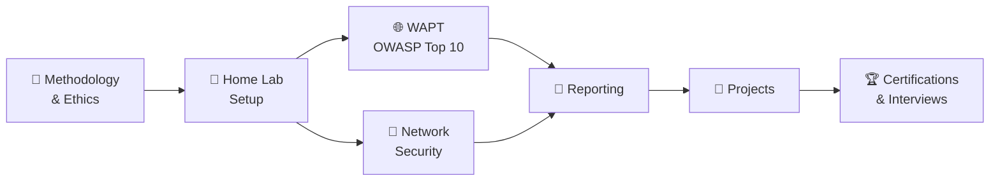

<!-- ===================== HEADER BANNER ===================== -->
<div align="center">


<a href="https://git.io/typing-svg">
  
</a>

<br/>


<p>
  <a href="#-about">About</a> •
  <a href="#-roadmap">Roadmap</a> •
  <a href="#-tools">Tools</a> •
  <a href="#-labs--writeups">Labs</a> •
  <a href="#-reports">Reports</a> •
  <a href="#-projects">Projects</a> •
  <a href="#-certifications">Certifications</a> •
  <a href="#-contact">Contact</a>
</p>

</div>

---

## 📌 About

> **This is not just a notes dump.** It is a structured, hands-on portfolio that shows how I find, exploit (ethically), report, and help fix security weaknesses in **web applications** and **networks**.

<table>
<tr>
<td width="50%" valign="top">

### 🌐 Web App Pentesting (WAPT)
- OWASP Top 10 testing
- Authentication & session flaws
- SQLi, XSS, CSRF, SSRF, XXE
- IDOR & broken access control
- API security testing
- Business logic flaws

</td>
<td width="50%" valign="top">

### 🔌 Network Security
- Scanning & enumeration
- Vulnerability assessment
- Sniffing & MITM
- Password attacks
- Active Directory basics
- Linux & Windows privilege escalation

</td>
</tr>
</table>

### 👤 Me

| | |
|---|---|
| 🧑 **Name** | `<Your Name>` |
| 🎯 **Focus** | Web & Network Penetration Testing |
| 📚 **Currently learning** | `<eJPT / PNPT / OSCP path>` |
| 📍 **Based in** | `<City, Country>` |

---

## 🎯 Learning Objectives

<details open>
<summary><b>Click to collapse / expand</b></summary>

- ✅ Pentesting methodologies: **PTES, OWASP WSTG, NIST SP 800-115**
- ✅ Test every **OWASP Top 10** category
- ✅ Exploit safely in **authorized lab environments**
- ✅ Write **professional reports** with remediation
- ✅ Map findings to **CVSS, CWE, OWASP, MITRE ATT&CK**
- ✅ Build small security tools in **Python / Bash**
- ✅ Prepare for **interviews and certifications**

</details>

---

## 🗺️ Roadmap



<details>
<summary><b>🌐 Web Application Pentesting modules</b></summary>

| # | Module | Status |
|---|--------|:------:|
| 01 | Recon & Information Gathering | ⬜ |
| 02 | Authentication & Session Management | ⬜ |
| 03 | Injection (SQLi, XSS, Command) | ⬜ |
| 04 | Broken Access Control & IDOR | ⬜ |
| 05 | CSRF, SSRF, XXE | ⬜ |
| 06 | File Upload, LFI/RFI | ⬜ |
| 07 | API Security Testing | ⬜ |
| 08 | Business Logic Flaws | ⬜ |

</details>

<details>
<summary><b>🔌 Network Security modules</b></summary>

| # | Module | Status |
|---|--------|:------:|
| 09 | Networking Fundamentals (TCP/IP, OSI) | ⬜ |
| 10 | Scanning & Enumeration (Nmap) | ⬜ |
| 11 | Vulnerability Assessment | ⬜ |
| 12 | Sniffing & MITM (Wireshark) | ⬜ |
| 13 | Password Attacks & Hashing | ⬜ |
| 14 | Active Directory Basics | ⬜ |
| 15 | Privilege Escalation (Linux & Windows) | ⬜ |
| 16 | Wireless Security | ⬜ |
| 17 | Hardening & Defense | ⬜ |

</details>

> **Legend:** ⬜ Not started &nbsp;•&nbsp; 🟨 In progress &nbsp;•&nbsp; ✅ Completed

### 📊 Progress


---

## 🛠️ Tools

<div align="center">


</div>

| Category | Tools |
|----------|-------|
| 🖥️ **Lab** | Kali Linux, VirtualBox / VMware, Docker |
| 🌐 **Web** | Burp Suite, OWASP ZAP, ffuf, Gobuster, sqlmap, Nikto, Nuclei |
| 🔌 **Network** | Nmap, Wireshark, Metasploit, Netcat, Hydra, John / Hashcat, Responder |
| 💻 **Scripting** | Python, Bash |

---

## 🧪 Practice Environments

> Only **legal, authorized** targets are used.

| Platform | Type |
|----------|------|
| 🧱 DVWA | Local vulnerable web app |
| 🧃 OWASP Juice Shop | Local vulnerable web app |
| 🎓 WebGoat | Guided web security lessons |
| 🔬 PortSwigger Academy | Free web security labs |
| 🟢 TryHackMe | Guided rooms |
| 🟩 HackTheBox | Machines & challenges |
| 💀 Metasploitable / VulnHub | Vulnerable VMs |
| 🏠 Home Lab | My own isolated VMs |

---

## 📁 Repository Structure

<details>
<summary><b>Click to view folder tree</b></summary>

```text
pentester-portfolio/
├── 00-methodology/                # PTES, WSTG, NIST 800-115, legal & ethics
├── 01-wapt/
│   ├── notes/                     # Web pentesting learning material
│   ├── labs/                      # DVWA, Juice Shop, WebGoat, PortSwigger
│   ├── tools/                     # Burp, ZAP, ffuf, sqlmap, nuclei
│   └── reports/
├── 02-network-security/
│   ├── notes/                     # Scanning, sniffing, AD, privesc, wireless
│   ├── labs/                      # Nmap, Wireshark, Metasploitable, HTB, THM
│   ├── tools/
│   └── reports/
├── 03-lab-reports/
│   ├── templates/                 # Lab, full pentest, executive summary
│   └── sample-report-dvwa.md
├── 04-cheatsheets/
├── 05-scripts/                    # My own Python / Bash tools
├── 06-certifications-and-roadmap/
├── assets/
└── .github/
```

</details>

---

## 🧪 Labs & Writeups

| # | Lab / Machine | Platform | Category | Difficulty | Writeup |
|:-:|---------------|----------|----------|:----------:|:-------:|
| 1 | _Coming soon_ | – | – | – | – |

---

## 📄 Reports

| Report | Scope | Key Findings | Link |
|--------|-------|--------------|:----:|
| 🧱 Sample: DVWA | Local lab | SQLi, XSS | [View](03-lab-reports/sample-report-dvwa.md) |

Every report contains: **Executive Summary → Methodology → Findings table (Severity, CVSS, CWE/OWASP) → Evidence/PoC → Impact → Remediation → References**.

---

## 🚀 Projects

| Project | Description | Status |
|---------|-------------|:------:|
| 🧱 DVWA Full Pentest Report | Professional report: SQLi, XSS and more | 📅 Planned |
| 🧃 Juice Shop Assessment | Full OWASP Top 10 test | 📅 Planned |
| 🏠 Internal Network Pentest | Scan, enumerate, exploit, report | 📅 Planned |
| 🏰 AD Attack Chain Lab | Enumeration to domain compromise, with detections | 📅 Planned |
| 🐍 Custom Port Scanner | Python tool with documentation | 📅 Planned |
| 🛡️ Detection Lab | Detect my own attacks with Suricata / logs | 📅 Planned |

---

## 🏆 Certifications

| Certification | Status |
|---------------|:------:|
| CompTIA Security+ | 📅 Planned |
| eJPT | 📅 Planned |
| PNPT | 📅 Planned |
| CEH | 📅 Planned |
| OSCP | 📅 Planned |

---

## 📅 Timeline: 16 Weeks

| Weeks | Focus |
|:-----:|-------|
| 1-2 | Methodology, lab setup, networking basics |
| 3-8 | Web Application Pentesting (OWASP Top 10) |
| 9-13 | Network pentesting, AD, privilege escalation |
| 14-15 | Full pentest projects & reporting |
| 16 | Portfolio polish & interview prep |

---

## ✅ My Progress

- [ ] Methodology, Legal & Ethics
- [ ] Home Lab Setup
- [ ] WAPT: Recon, Auth, Injection
- [ ] WAPT: Access Control, CSRF/SSRF/XXE, File Upload
- [ ] WAPT: API & Business Logic
- [ ] Network: Scanning, Enumeration, Vuln Assessment
- [ ] Network: Sniffing, Password Attacks
- [ ] Network: Active Directory & Privilege Escalation
- [ ] Network: Wireless & Hardening
- [ ] Professional Reports
- [ ] Real-World Projects
- [ ] Interview Preparation

---

## 📚 Resources

[](https://owasp.org/www-project-web-security-testing-guide/)
[](https://portswigger.net/web-security)
[](https://tryhackme.com)
[](https://www.hackthebox.com)
[](https://attack.mitre.org)
[](https://book.hacktricks.xyz)

---

## 📬 Contact

<div align="center">

[](https://linkedin.com/in/your-profile)
[](https://tryhackme.com/p/your-profile)
[](https://app.hackthebox.com/profile/your-id)
[](mailto:your-email@example.com)

</div>

---

## ⚠️ Legal Disclaimer

> [!WARNING]
> This repository is for **educational and defensive security purposes only**.
>
> - Test **only** systems I own or have **explicit written authorization** to test.
> - Unauthorized access is illegal.
> - Never upload real credentials, API keys, client data, real IPs, or sensitive screenshots.
> - Follow each platform's rules (do not publish write-ups of active HackTheBox machines).
> - The author is not responsible for misuse of this information.

---

## 🤝 Contributing & License

Suggestions and corrections are welcome. Please read [`CONTRIBUTING.md`](CONTRIBUTING.md) first.
Licensed under the **MIT License**.

<div align="center">

⭐ **If you find this repository useful, consider giving it a star!** ⭐

**Repository Status:** 🚧 Actively Under Development


</div>
